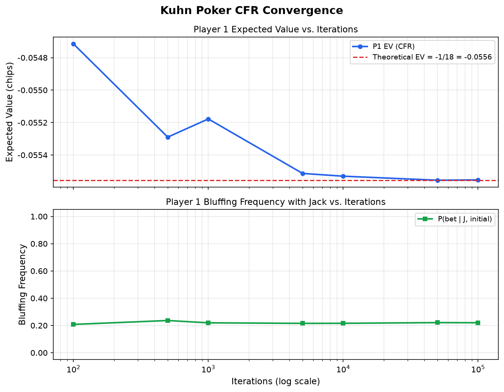

# Kuhn Poker CFR Solver

> A clean, mathematically rigorous implementation of **Counterfactual Regret Minimization (CFR)** applied to Kuhn Poker — designed to demonstrate algorithmic game theory for quantitative finance and trading applications.

---

## Game Description — Kuhn Poker

Kuhn Poker is the canonical minimal poker model introduced by Harold W. Kuhn (1950) to study mixed-strategy equilibria in imperfect-information sequential games.

**Rules:**
- **Deck:** 3 cards — Jack (J), Queen (Q), King (K), ranked J < Q < K.
- **Setup:** Each player antes 1 chip. One card is dealt privately to each player.
- **Action sequence (alternating):**
  1. **Player 1** checks (`p`) or bets (`b`).
  2. If P1 checked → **Player 2** checks (`p`, terminal) or bets (`b`).
     - If P2 bet → **Player 1** folds (`p`, P2 wins) or calls (`b`, showdown).
  3. If P1 bet → **Player 2** folds (`p`, P1 wins) or calls (`b`, showdown).
- **Showdown:** Higher card wins the pot.

**Terminal histories** (action strings):

| History | Outcome |
|---------|---------|
| `pp`  | Check-check → showdown (pot 2) |
| `pbp` | P1 checks, P2 bets, P1 folds → P2 wins 1 chip |
| `pbb` | P1 checks, P2 bets, P1 calls → showdown (pot 4) |
| `bp`  | P1 bets, P2 folds → P1 wins 1 chip |
| `bb`  | P1 bets, P2 calls → showdown (pot 4) |

---

## Mathematical Background — CFR

### Information Sets

An **information set** (infoset) groups all game states indistinguishable to the acting player. In Kuhn Poker, each infoset is uniquely identified by:

```
<private_card><action_history>
```

e.g., `Jpb` = "I hold a Jack, P1 checked, P2 bet, now P1 must act."

There are **12 information sets** in total (3 cards × 4 decision nodes).

### Counterfactual Regret

For each infoset $I$ and action $a$ at iteration $t$, define the **counterfactual value**:

$$v^\sigma(I, a) = \text{expected payoff if player } i \text{ plays action } a \text{ at } I, \text{ but } \sigma \text{ everywhere else}$$

The **counterfactual regret** for action $a$ at iteration $t$ is:

$$r^t(I, a) = v^\sigma(I, a) - \sum_{a'} \sigma^t(I, a') \cdot v^\sigma(I, a')$$

The **cumulative regret** is:

$$R^T(I, a) = \sum_{t=1}^{T} r^t(I, a)$$

### Regret Matching

At each iteration, the strategy is computed via **regret matching**:

$$\sigma^{t+1}(I, a) = \frac{\max(R^T(I, a),\, 0)}{\displaystyle\sum_{a'} \max(R^T(I, a'),\, 0)}$$

If all cumulative regrets are ≤ 0, play uniformly at random.

### Nash Approximation

The **average strategy** over all iterations converges to a Nash equilibrium by the CFR theorem (Zinkevich et al., 2007):

$$\bar{\sigma}(I, a) = \frac{\displaystyle\sum_{t=1}^{T} \pi_i^t(I) \cdot \sigma^t(I, a)}{\displaystyle\sum_{t=1}^{T} \pi_i^t(I)}$$

where $\pi_i^t(I)$ is player $i$'s **reach probability** to infoset $I$ under $\sigma^t$.

The exploitability bound is $O(1/\sqrt{T})$. In practice, deterministic traversal (full tree per iteration) gives faster empirical convergence than Monte Carlo sampling.

---

## Converged Strategy Matrix

After 100,000 iterations the solver converges to the following Nash equilibrium approximation. Actions are `p` (pass/check/fold) and `b` (bet/call).

| Info Set | Actor | Situation | P(pass) | P(bet) |
|----------|:-----:|-----------|:-------:|:------:|
| `J`   | P1 | P1 holds J, initial action | 0.7800 | 0.2200 |
| `Q`   | P1 | P1 holds Q, initial action | 1.0000 | 0.0000 |
| `K`   | P1 | P1 holds K, initial action | 0.3370 | 0.6630 |
| `Jp`  | P2 | P2 holds J, P1 checked     | 0.6682 | 0.3318 |
| `Qp`  | P2 | P2 holds Q, P1 checked     | 1.0000 | 0.0000 |
| `Kp`  | P2 | P2 holds K, P1 checked     | 0.0000 | 1.0000 |
| `Jpb` | P1 | P1 holds J, checked, P2 bet | 1.0000 | 0.0000 |
| `Qpb` | P1 | P1 holds Q, checked, P2 bet | 0.4447 | 0.5553 |
| `Kpb` | P1 | P1 holds K, checked, P2 bet | 0.0000 | 1.0000 |
| `Jb`  | P2 | P2 holds J, P1 bet         | 1.0000 | 0.0000 |
| `Qb`  | P2 | P2 holds Q, P1 bet         | 0.6641 | 0.3359 |
| `Kb`  | P2 | P2 holds K, P1 bet         | 0.0000 | 1.0000 |

> **Game-theoretic observations:**
> - **P1 bluffs with J** ~22% of the time; bets the nut K ~66%.
> - **P2 with J never calls** a bet (strictly dominated — Jack loses to all).
> - **P2 with Q calls** ~34% to prevent P1 exploiting a pure bluff with J.
> - The equilibrium is parameterized by one free variable α ∈ [0, 1/3]; CFR finds one particular solution with P1 EV = **−1/18 ≈ −0.0556** chips/game.

---

## Convergence Plot



*Top: P1 expected value (exact tree evaluation) converging to the theoretical −1/18. Bottom: P1 bluffing frequency (P(bet | Jack)) stabilizing near equilibrium.*

---

## Project Structure

```
quant_project/
├── kuhn_cfr.py          # Core CFR solver: InfoSet, KuhnCFRTrainer
├── main.py              # Training loop, exact EV, strategy table, plot
├── test_cfr.py          # pytest unit tests (5 tests across 4 classes)
├── convergence_plot.png # Generated by main.py
└── README.md
```

---

## Setup & Execution

### Prerequisites

```bash
pip install matplotlib numpy pytest
```

### Train the solver and view results

```bash
python main.py
```

This will:
1. Run CFR for 100,000 iterations (incremental at log-spaced milestones).
2. Print convergence table — exact EV, error vs. −1/18, bluff frequency.
3. Display the Nash equilibrium strategy table.
4. Save `convergence_plot.png`.

Expected terminal output (excerpt):
```
Iterations |      P1 EV |   EV error |   Bluff(J)
----------------------------------------------------
       100 |  -0.054715 |  +0.000841 |     0.2079
     1,000 |  -0.055178 |  +0.000378 |     0.2195
    10,000 |  -0.055531 |  +0.000025 |     0.2159
   100,000 |  -0.055554 |  +0.000002 |     0.2200
```

### Run tests

```bash
pytest test_cfr.py -v
```

Expected output: **5 passed**.

---

## Key Results

| Metric | Theoretical | CFR (100k iters) |
|--------|:-----------:|:-------------------:|
| P1 Expected Value | −1/18 ≈ −0.05556 | −0.05555 (error < 0.0001) |
| P(call \| J, facing bet) | 0 | < 0.0001 |
| P1 initial bluff rate (J) | α ∈ [0, 1/3] | ~0.22 |
| Convergence rate | O(1/√T) | Empirically verified |

---

## References

1. Kuhn, H. W. (1950). *Simplified two-person poker*. Contributions to the Theory of Games.
2. Zinkevich, M., Johanson, M., Bowling, M., & Piccione, C. (2007). *Regret minimization in games with incomplete information*. NeurIPS.
3. Nisan, N. et al. (2007). *Algorithmic Game Theory*. Cambridge University Press.
